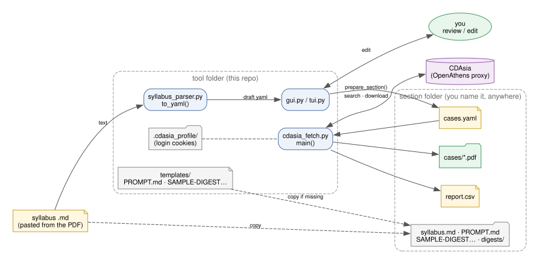
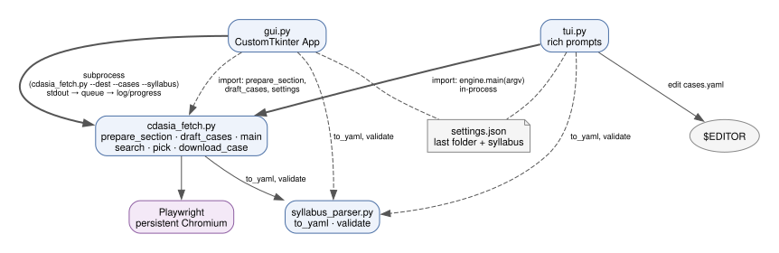
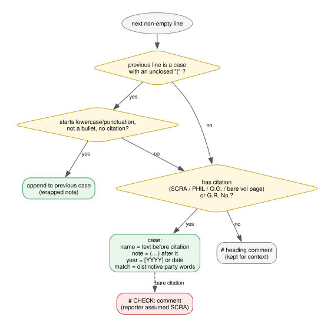
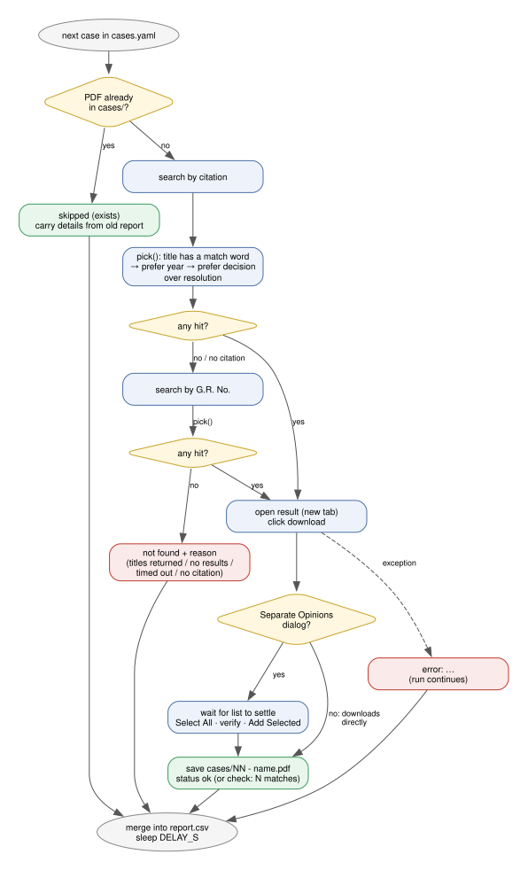

# Architecture

How the CDAsia case downloader is put together. For how to *use* it, see [README.md](README.md).

## Overview



This folder is the **tool**; it never holds downloaded cases. Each run fills a **section folder** the
user names and places anywhere (e.g. `~/Downloads/<section>`).

## Files



| File | Role |
| --- | --- |
| `cdasia_fetch.py` | Engine and CLI. Prepares the section folder, drives the browser, downloads, writes `report.csv`. |
| `syllabus_parser.py` | Syllabus text → draft yaml (`to_yaml`), and yaml text → validated case list (`validate`). No browser, no I/O beyond its CLI. |
| `gui.py` | CustomTkinter desktop app. Edits the yaml in place; runs the engine as a child process. |
| `tui.py` | rich terminal app. Edits the yaml with `$EDITOR`; calls `engine.main()` in-process. |
| `syllabi/` | Syllabus `.md` files listed by both UIs (any other path can be browsed to). Only `example-*` files are tracked: the example syllabus and its reviewed yaml. |
| `templates/` | `PROMPT.md` and `SAMPLE-DIGEST-STYLE-TO-FOLLOW.md`: instructions and a style sample for writing the digests (by an AI assistant, from the PDFs). Copied into every section folder. |
| `docs/diagrams/` | Graphviz sources (`.dot`) for the diagrams here, rendered to `.svg` by `render.sh`. |
| `settings.json` | Last-used parent folder and syllabus, shared by the UIs. Gitignored. |
| `.cdasia_profile/` | Chromium profile holding the CDAsia/OpenAthens session cookies. Gitignored; never commit it. |

## Section folder contract

```
<section>/
  cases/NN - <name>.pdf   NN = position in cases.yaml; existing files are skipped on rerun
  digests/                 empty; for the digests PROMPT.md asks for
  cases.yaml               the reviewed list (rewritten on every run from what was downloaded against)
  syllabus.md              copy of the syllabus; also how a rerun recognises "same syllabus"
  PROMPT.md, SAMPLE-DIGEST-STYLE-TO-FOLLOW.md   copied only if missing, so per-section edits survive
  report.csv               one row per case, merged across runs (keyed by file name)
```

`prepare_section()` creates this; `draft_cases()` decides what yaml to show for review: the folder's own
`cases.yaml` if its `syllabus.md` is identical to the chosen syllabus (keeps earlier edits), else a fresh
parse.

## Case list format

A yaml list; one mapping per case:

| key | meaning |
| --- | --- |
| `name` | Used in the PDF file name and the report. Required. |
| `citation` | e.g. `156 SCRA 549`, `50 Phil 259`. Searched first. |
| `gr` | G.R. No., e.g. `104732` or `L-17169`. Searched if the citation finds nothing usable. |
| `match` | Words (any one) that must appear in the CDAsia result title. Compared case- and accent-insensitively. |
| `year` | Preferred among several matching results. |
| `note` | The prof's note; copied to `report.csv` only. |

`validate()` requires a list, a `name` on each item, and a `citation` or `gr`.

## Syllabus parser

The syllabus is text copy-pasted from a PDF, so lines are hard-wrapped and formatting is loose.



Rules:

1. **Rejoin wrapped lines.** A line is appended to the previous case while that case has an unclosed `(`
   *and* the line starts in lowercase or punctuation (wrapped notes do; headings start uppercase), is not
   a bullet, and has no citation of its own.
2. **A case is a line with a citation or G.R. No.** Patterns: `<vol> SCRA|PHIL|O.G. <page>`,
   `G.R. No(s). [L-]<n>`, and a bare `<vol> <page> [year]` (reporter missing; assumed SCRA and marked
   `# CHECK:`). Every other line becomes a `#` comment, so headings stay visible during review.
3. **Fields.** `name` = text before the first citation/G.R. (bullets, `OPTIONAL:` and trailing dashes
   stripped; `OPTIONAL` appended as `(OPTIONAL)`). `note` = the parenthesised text after it. `year` from
   `[1993]` or a written date. `match` = up to four distinctive words from the party names (stop-words
   such as *People*, *Republic*, *CA*, *Jr*, *III* excluded).

It copies the syllabus as written, typos included; the review step is where they get fixed.

## Engine (`cdasia_fetch.py`)

`main(argv)` picks the yaml (`--cases`, else `<dest>/cases.yaml`, else parse `--syllabus`), validates it,
prepares the folder, then for each case:




1. Skip if the PDF exists (carry its details over from the previous report).
2. Search CDAsia by `citation`, then `gr`, via URL (`/?result=true&citation=…` or `&number=…`). A
   citation search returns every decision on that page, which is why `match` exists.
3. `pick()`: keep results whose title contains a `match` word, prefer `year`, prefer the decision over
   later resolutions. Several left → take the first, status `check: N matches`.
4. `download_case()`: open the row (new tab), click `[aria-label=download-button]`. CDAsia either
   downloads at once (no separate opinions) or opens an *Include Separate Opinions* dialog; then wait for
   the opinion list to stop growing, *Select All*, verify every box is checked, *Add Selected Opinions*.
   The page keeps a hidden copy of the dialog, so selectors use `:visible`.
5. Record a status, sleep `DELAY_S` (4 s) to go easy on the site.

Failures never stop the run; each gets a reason (no title matched + what CDAsia returned / no results /
timeout / no citation). Exit code 1 if any case needs attention.

**Login.** A persistent Chromium context (`.cdasia_profile/`, headed). `ensure_logged_in()` waits up to
10 minutes for CDAsia's search box (`#input-Number`), so an OpenAthens login in that window just works.
On a campus network with IP-based access no login is needed. `BASE` comes from the `CDASIA_URL`
environment variable (default: the OpenAthens proxy the tool was built with), so other institutions'
proxies work without code changes.

## UIs

- **GUI** runs `cdasia_fetch.py` with `python -u` in a subprocess; a reader thread puts stdout lines on a
  queue that the Tk loop drains every 100 ms. Progress counts lines matching `[NN] name:`. Stop =
  `terminate()`. The yaml editor is validated 400 ms after typing stops.
- **TUI** writes the draft to `<dest>/cases.yaml`, shows it (syntax + table), loops on
  download / edit / regenerate / quit, then calls `engine.main()` directly and prints the report.

Both communicate with the engine only through its CLI arguments and the section folder, so the engine
stays usable on its own.

## Environment

macOS, Homebrew Python 3.13 venv (`.venv`), `python-tk@3.13` for Tk 9, Playwright's bundled Chromium.
Dependencies: `playwright`, `pyyaml`, `customtkinter`, `rich`. Paths printed by the engine and the GUI
show the home folder as `~` (`shown()`), and "Open folder" uses `open`, `xdg-open` or `os.startfile`
depending on the platform.

## Editing the diagrams

The diagrams are Graphviz files in `docs/diagrams/`. Edit a `.dot`, then run `docs/diagrams/render.sh`
(needs `brew install graphviz`) and commit both the `.dot` and the regenerated `.svg`. Keep them in step
with the code: a new module, step in the per-case flow, or parser rule should show up in the diagram too.
