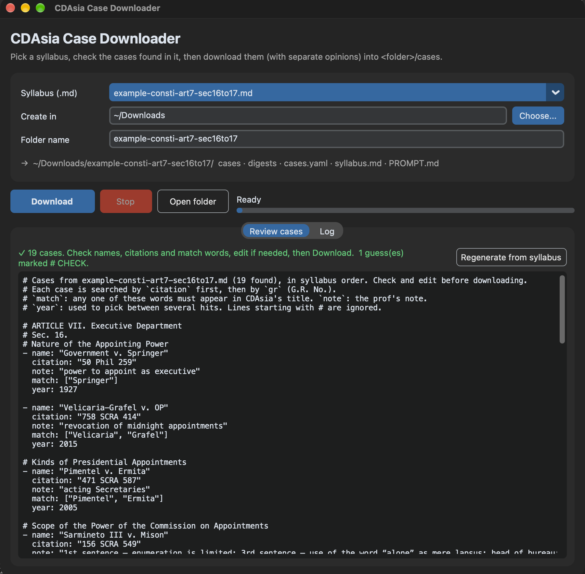
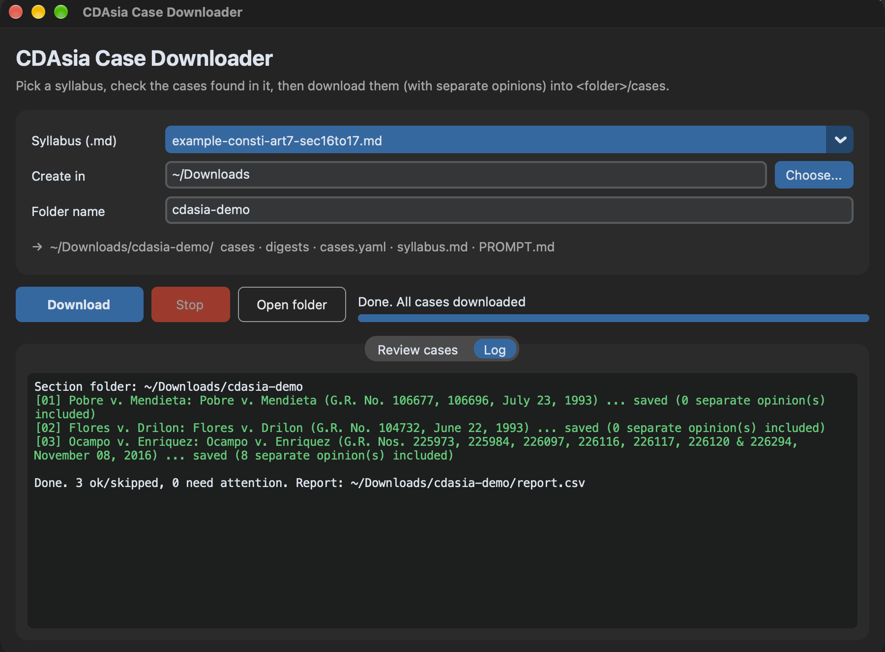

# CDAsia Case Downloader

A desktop tool for law students: paste the part of the course syllabus you need, check the case list
it finds, and it downloads every case from [CDAsia](https://cdasiaonline.com) (the Philippine
jurisprudence database), **with all separate opinions**, into a folder ready for writing digests.

Built with Python, Playwright, CustomTkinter and rich.



## Why

A typical syllabus section lists 15–20 Supreme Court cases by citation (`156 SCRA 549`) or docket number
(`G.R. No. 104732`), often with typos. Fetching each one by hand means a search, picking the right
result among decisions on the same page, ticking every concurring and dissenting opinion, and renaming the
PDF. This tool does it in one pass, and says exactly why a case couldn't be found when it can't.

## Features

- **Syllabus in, PDFs out.** Pasted syllabus text is parsed into a case list: citations, G.R. Nos., the
  professor's notes, and words to recognise the right result. Lines it had to guess at are flagged.
- **Review before downloading.** The list opens in an editor (GUI) or your `$EDITOR` (terminal UI) so
  typos in the syllabus get fixed first.
- **All separate opinions included** in each PDF, verified before saving.
- **Resumable and safe to rerun.** Finished cases are skipped; a pause between cases keeps the load on
  the site low.
- **Clear failure reasons** in `report.csv`: what CDAsia returned, no results, timeout, or ambiguous match.
- **One folder per syllabus section**, with the PDFs, the syllabus, and a prompt + style sample for
  writing the digests with an AI assistant.
- Desktop GUI, terminal UI, or plain CLI over the same engine.



## Requirements

- **CDAsia access through your institution.** The tool uses your own login; it doesn't bypass anything.
  It defaults to the OpenAthens proxy it was built for; see [Configuration](#configuration) for others.
- Python 3.10+ with Tk (for the GUI), and Playwright's Chromium.
- Developed on macOS; the code avoids macOS-only calls, but Windows and Linux are untested.

## Setup

```sh
git clone <this repo> && cd <repo>
python3 -m venv .venv
.venv/bin/pip install -r requirements.txt
.venv/bin/playwright install chromium
```
On macOS with Homebrew Python, the GUI also needs Tk: `brew install python-tk@3.13` (match your Python version).

## Usage

```sh
.venv/bin/python gui.py     # desktop app
.venv/bin/python tui.py     # terminal app
```

1. **Syllabus.** Paste the part of the syllabus you need into a `.md` file. Files in `syllabi/` show up in
   the list (try `example-consti-art7-sec16to17.md`); anywhere else, browse to it.
2. **Folder.** Choose where to create the section folder and name it.
3. **Review.** Each line with a citation or G.R. No. becomes a case, the text in parentheses becomes its
   `note`, and headings stay as `#` comments. Fix what the syllabus got wrong and check lines marked
   `# CHECK:`. Compare `syllabi/example-consti-art7-sec16to17.reviewed.yaml` for a list after review.
4. **Download.** A Chromium window opens. If you're not logged in, sign in (e.g. through OpenAthens) in
   that window; the tool continues once the CDAsia search page appears. The session is kept in
   `.cdasia_profile/`, so this is usually needed only once.

Rerunning into the same folder reuses your reviewed list and skips cases already downloaded. Without a UI:
```sh
.venv/bin/python cdasia_fetch.py --syllabus syllabi/x.md --dest ~/Downloads/x [--only Ocampo]
```

### What you get

```
<section folder>/
  cases/          01 - Government v. Springer.pdf, ... (numbered in syllabus order, with opinions)
  digests/        empty, for your digests
  cases.yaml      the reviewed case list
  syllabus.md     the syllabus you gave it
  PROMPT.md, SAMPLE-DIGEST-STYLE-TO-FOLLOW.md   from templates/, for writing the digests
  report.csv      per case: status, matched title, G.R. No., date, opinions included, the prof's note
```

### Writing the digests

Open the section folder in an AI assistant (e.g. Claude) and ask it to follow `PROMPT.md`: it reads the
PDFs, the syllabus and the style sample, and writes into `digests/`. Edit `templates/` to change the
default for future folders, or a section's own copy to change just that one.

### The case list format

| key | |
| --- | --- |
| `name` | used for the file name and report |
| `citation` | e.g. `156 SCRA 549`, `50 Phil 259`; searched first |
| `gr` | G.R. No., e.g. `104732`, `L-17169`; searched if the citation finds nothing |
| `match` | words (any one) that must appear in CDAsia's result title |
| `year` | preferred when several results match |
| `note` | free text, copied into the report |

## When a case can't be found

The run never stops on a missing case; `report.csv` says why:
- **no result title matched `match`; CDAsia returned: …**: CDAsia has something for that citation, but
  not with that title. If one of the listed titles is right, fix `match` and download again.
- **CDAsia has no results for the citation or G.R. No.**: usually a typo in the syllabus; otherwise the
  case isn't on CDAsia (try the SC E-Library or LawPhil).
- **search timed out**: the site was slow or the login expired; rerun.
- **check: N matches, took first**: downloaded, but open the PDF to confirm it's the right case.

## Configuration

| | |
| --- | --- |
| `CDASIA_URL` env var | CDAsia base URL. Default: the OpenAthens proxy it was built with (`https://cdasiaonline-com.ap2.proxy.openathens.net`). Use your institution's proxy URL, or `https://cdasiaonline.com` for direct access. |
| `DELAY_S` in `cdasia_fetch.py` | pause between cases (default 4 s) |
| `templates/` | the digest prompt and style sample copied into each folder |
| `settings.json` | created by the UIs to remember the last folder and syllabus (not committed) |

## Troubleshooting

- **`No module named '_tkinter'`**: install Tk for your Python (macOS: `brew install python-tk@3.13`) and
  run with `.venv/bin/python`.
- **Stuck at "Waiting until the CDAsia search page appears"**: finish logging in in the Chromium window (it
  waits 10 minutes). If login keeps failing, delete `.cdasia_profile/` and retry.
- **Wrong case downloaded**: delete that PDF, make `match`/`year` more specific or add the `gr`, rerun.
- **Every case fails with an error**: CDAsia probably changed its page layout; the selectors in
  `download_case()` need updating (see [ARCHITECTURE.md](ARCHITECTURE.md)).

## Project layout

```
cdasia_fetch.py      engine + CLI: browser automation, search, matching, download, report
syllabus_parser.py   syllabus text -> case list (yaml), and validation
gui.py               desktop app (CustomTkinter)
tui.py               terminal app (rich)
syllabi/             syllabus files; only example-* is tracked, your own stay local
templates/           PROMPT.md and SAMPLE-DIGEST-STYLE-TO-FOLLOW.md, copied into each section folder
docs/                diagrams (Graphviz) and screenshots
```

More: [ARCHITECTURE.md](ARCHITECTURE.md) (design, with diagrams) · [PLAN.md](PLAN.md) (status, known
limitations, ideas) · [CHANGELOG.md](CHANGELOG.md) · [CLAUDE.md](CLAUDE.md) (notes for AI coding assistants)

## Disclaimer

Not affiliated with or endorsed by CD Technologies Asia, Inc. or OpenAthens. Use it only with access you
are entitled to, and within your institution's and CDAsia's terms of use. It fetches the cases you list,
one at a time, for personal study. Downloaded cases are not part of this repository.

## License

[MIT](LICENSE)
